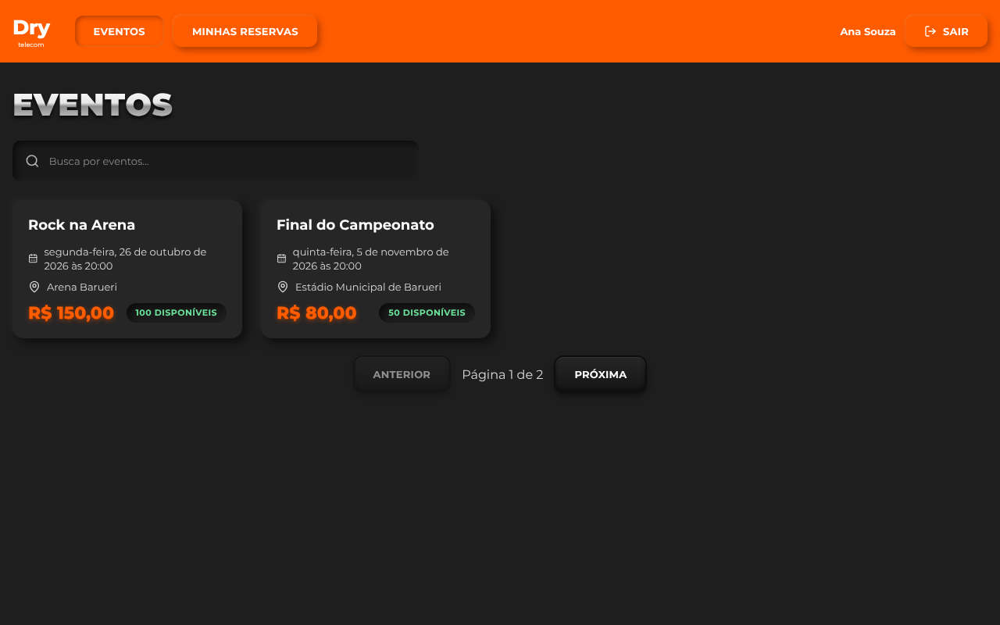
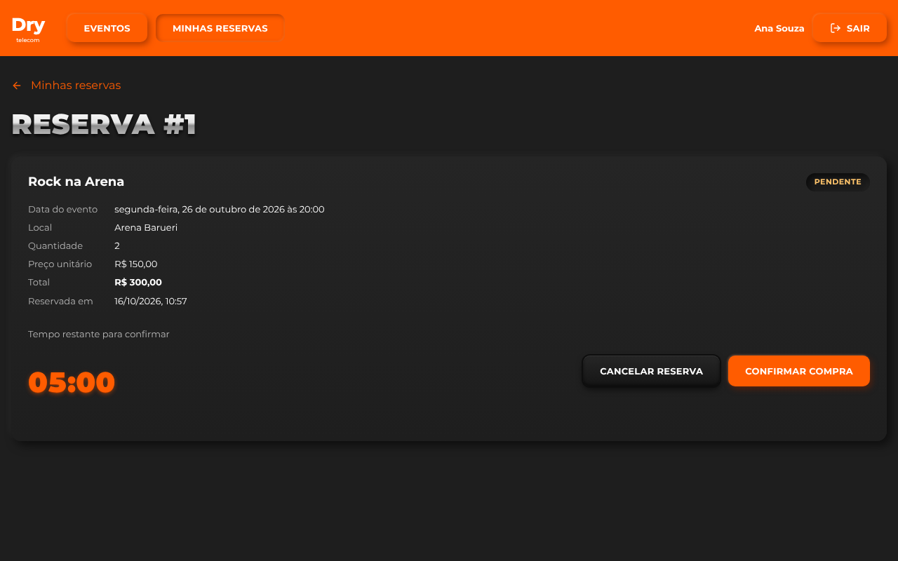
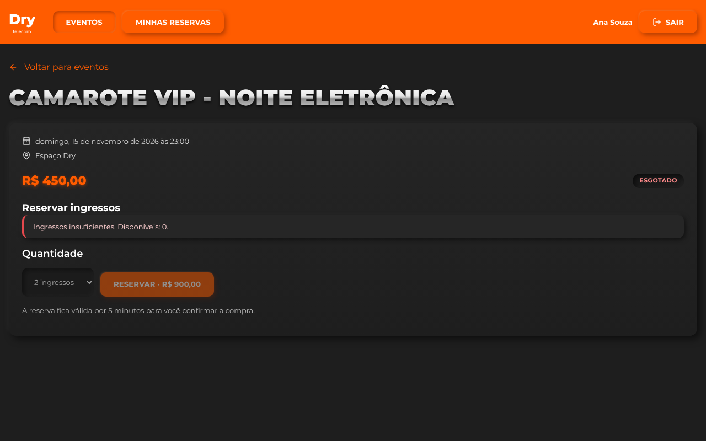

# Reserva de ingressos

Aplicação web para consultar eventos, reservar ingressos por tempo limitado (5 minutos) e confirmar uma compra simulada, **sem nunca vender além da capacidade**, mesmo com requisições simultâneas vindas de mais de uma instância do backend.

React + Node.js, com TypeScript nos dois lados e SQLite como banco relacional.

| Catálogo | Reserva com contagem regressiva | Conflito (409) tratado |
|---|---|---|
|  |  |  |

Documentos complementares:
- [`docs/DECISOES.md`](docs/DECISOES.md): estrutura, autenticação, concorrência, expiração, histórico de decisões e limitações.
- [`AI_USAGE.md`](AI_USAGE.md): como a IA foi usada e validada.

---

## Sumário

1. [Pré-requisitos](#pré-requisitos)
2. [Instalação e execução](#instalação-e-execução)
3. [Contas de demonstração](#contas-de-demonstração)
4. [Configuração (.env)](#configuração-env)
5. [Banco de dados, migrations e seed](#banco-de-dados-migrations-e-seed)
6. [Testes](#testes)
7. [Contrato da API](#contrato-da-api)
8. [Stack e versões](#stack-e-versões)
9. [Estrutura do projeto](#estrutura-do-projeto)
10. [O que funciona, limitações e próximos passos](#o-que-funciona-limitações-e-próximos-passos)

---

## Pré-requisitos

| Ferramenta | Versão | Observação |
|---|---|---|
| Node.js | **22.13 ou superior** | Usa o módulo nativo `node:sqlite`. Testado no Node 22.22 (Linux) e 26.10 (Windows) |
| npm | 10 ou superior | Vem junto com o Node |
| Git | qualquer | |

**Não é preciso** instalar banco de dados, Docker, Python nem compilador. O SQLite vem embutido no Node e não há dependências nativas.

## Instalação e execução

**Windows (PowerShell):**
```powershell
git clone https://github.com/gustlok1/reserva-ingressos.git
cd reserva-ingressos
npm install
Copy-Item backend/.env.example backend/.env
npm run db:setup
```

**Linux / macOS:**
```bash
git clone https://github.com/gustlok1/reserva-ingressos.git
cd reserva-ingressos
npm install
cp backend/.env.example backend/.env
npm run db:setup
```

Depois, em **dois terminais** na raiz do projeto:

```bash
npm run dev:api   # backend em http://localhost:3333
npm run dev:web   # frontend em http://localhost:5173  ← abra este no navegador
```

O frontend repassa as chamadas `/api` para o backend (proxy do Vite). Como tudo fica na mesma origem, o cookie de sessão funciona sem configurar CORS.

### Comandos disponíveis (na raiz)

| Comando | O que faz |
|---|---|
| `npm install` | Instala as dependências dos dois projetos (npm workspaces, lockfile único) |
| `npm run db:setup` | Aplica as migrations pendentes e roda o seed. Pode ser executado várias vezes sem duplicar registros |
| `npm run db:reset` | Apaga o arquivo do banco e recria do zero. **Pare o backend antes** (no Windows o arquivo fica travado) |
| `npm run dev:api` | Sobe o backend com recarga automática |
| `npm run dev:web` | Sobe o frontend com recarga automática |
| `npm test` | Roda todos os testes automatizados (backend e frontend) |

## Contas de demonstração

| Usuário | E-mail | Senha |
|---|---|---|
| Ana Souza | `ana@exemplo.com` | `senha123` |
| Bruno Lima | `bruno@exemplo.com` | `senha123` |

Eventos criados pelo seed (datas relativas ao dia em que o seed roda, sempre futuras):

| Evento | Capacidade | Preço | Data |
|---|---|---|---|
| Rock na Arena | 100 | R$ 150,00 | hoje + 10 dias, 20h (Brasília) |
| Final do Campeonato | 50 | R$ 80,00 | hoje + 20 dias, 20h |
| Camarote VIP - Noite Eletrônica | **2** | R$ 450,00 | hoje + 30 dias, 20h |

> **Para demonstrar o conflito:** abra uma janela normal com a Ana e uma anônima com o Bruno, as duas no Camarote. A Ana reserva 2 ingressos; o Bruno tenta reservar 2 sem recarregar a página e recebe a mensagem de ingressos insuficientes, com a disponibilidade atualizada na tela.

## Configuração (.env)

O arquivo `backend/.env.example` não contém segredos. Copie para `backend/.env`.

| Variável | Padrão | Descrição |
|---|---|---|
| `PORT` | `3333` | Porta do backend |
| `DATABASE_PATH` | `./data/reservas.db` | Caminho do arquivo SQLite (relativo à pasta `backend/`) |
| `SESSION_TTL_HOURS` | `8` | Duração da sessão de login |
| `RESERVATION_TTL_SECONDS` | `300` | Validade de uma reserva pendente. Use `30` para demonstrar a expiração sem esperar 5 minutos |

## Banco de dados, migrations e seed

- **SQLite** pelo módulo nativo `node:sqlite`. O banco é o arquivo `backend/data/reservas.db`, criado pelo `db:setup` e fora do Git. Pode ser aberto com o DB Browser for SQLite ou uma extensão do VS Code.
- **Migrations:** arquivos SQL numerados em `backend/src/db/migrations/`. O runner (`backend/src/db/migrate.ts`) aplica, em ordem, os que ainda não estão na tabela `schema_migrations`. Cada migration roda numa transação.
- **Seed** (`backend/src/db/seed.ts`): `INSERT ... ON CONFLICT DO NOTHING` sobre chaves únicas (`users.email`, `events.slug`). Rodar de novo não duplica nem sobrescreve.
- **Persistência:** reiniciar o backend preserva reservas e prazos, porque a validade depende só de `expires_at`, gravado no banco.

Tabelas: `users`, `sessions`, `events` e `reservations`. Valores monetários em centavos (`INTEGER`) e datas em ISO-8601 UTC. O banco também tem `CHECK` na quantidade (1 a 4) e no total (`quantity * unit_price_cents`).

## Testes

```bash
npm test
```

São 50 testes, em cerca de 10 segundos. O backend roda contra o **SQLite real** (em memória ou em arquivo temporário), sem simular a proteção de concorrência. O relógio é injetado e controlado nos testes.

| Cenário obrigatório | Onde | O que é verificado |
|---|---|---|
| 1. Fluxo e repetição | `backend/tests/reservations.test.ts` | Criar, confirmar e confirmar de novo devolve a mesma reserva; capacidade consumida uma vez; linha única no banco |
| 2. Concorrência | `backend/tests/concurrency.test.ts` | **Dois servidores reais em processos separados**, mesmo arquivo: 2 + 2 ingressos com capacidade 2 dá um 201 e um 409; 40 reservas simultâneas de 1 ingresso com capacidade 5 dão exatamente 5 sucessos. Saldo e reservas conferidos no banco |
| 3. Expiração | `backend/tests/reservations.test.ts` | 1 ms antes, exatamente em `expiresAt` e depois: aparece EXPIRADA, a confirmação é recusada e outro usuário consegue reservar |
| 4. Cancelamento | `backend/tests/reservations.test.ts` | Cancelar libera a quantidade; repetir responde 409 sem liberar a mais; reserva confirmada não pode ser cancelada |
| 5. Acesso | `backend/tests/reservations.test.ts` | 401 sem autenticação; outro usuário recebe 404 ao consultar, confirmar ou cancelar e não vê a reserva na listagem |
| 6. Interface | `frontend/src/test/app.test.tsx` | 409 simulado com MSW: mensagem compreensível, fim do carregamento e disponibilidade recarregada sem atualizar a página |

Também são testados: validação (quantidade 0, fracionária, acima de 4, texto), payload adulterado (preço, total, status e usuário ignorados), evento já iniciado, autenticação (hash da senha e do token, expiração e logout), busca e paginação, migrations e seed idempotentes.

**Contraprova:** com a transação removida temporariamente, os testes de concorrência entre processos falham com venda excedente. O mesmo vale para o cenário 6: sem a atualização após o 409, o teste falha. Detalhes em [`docs/DECISOES.md`](docs/DECISOES.md#concorrência).

## Contrato da API

Base: `http://localhost:3333/api` (ou `http://localhost:5173/api` pelo proxy). Corpo em JSON. Todas as rotas, exceto `/auth/login` e `/health`, exigem o cookie de sessão.

### Formato de erro

```json
{ "error": { "code": "INSUFFICIENT_AVAILABILITY", "message": "Ingressos insuficientes. Disponíveis: 0." } }
```

Erros de validação trazem `details: [{ "field": "quantity", "message": "..." }]`. Stack traces nunca são expostos.

| Status | Quando | Códigos |
|---|---|---|
| 400 | Entrada inválida | `VALIDATION_ERROR`, `INVALID_JSON` |
| 401 | Sem sessão, sessão expirada ou login inválido | `UNAUTHORIZED` |
| 404 | Recurso inexistente **ou reserva de outro usuário** | `NOT_FOUND` |
| 409 | Sem ingressos suficientes, evento já iniciado, reserva expirada, estado incompatível | `INSUFFICIENT_AVAILABILITY`, `EVENT_STARTED`, `RESERVATION_EXPIRED`, `INVALID_RESERVATION_STATE` |

**Política de acesso:** a reserva de outro usuário responde **404**, idêntica a uma inexistente, para não revelar que ela existe.

### Acesso

**`POST /api/auth/login`**
```json
// requisição
{ "email": "ana@exemplo.com", "password": "senha123" }
// 200 + Set-Cookie: session=<token>; HttpOnly; SameSite=Lax
{ "user": { "id": 1, "email": "ana@exemplo.com", "name": "Ana Souza" }, "expiresAt": "2026-10-16T20:00:00.000Z" }
```
E-mail inexistente e senha errada recebem o mesmo `401`.

**`GET /api/auth/me`**: identidade do usuário logado.
```json
{ "user": { "id": 1, "email": "ana@exemplo.com", "name": "Ana Souza" } }
```

**`POST /api/auth/logout`** → `204`. Apaga a sessão no banco e limpa o cookie.

**Estratégia de sessão:** token opaco de 32 bytes aleatórios num cookie `HttpOnly` e `SameSite=Lax` (`Secure` em produção). O banco guarda só o **hash SHA-256** do token. A sessão expira em `SESSION_TTL_HOURS` (8h) a partir do login, sem renovação automática. O logout invalida na hora, porque a linha é apagada. Uma sessão expirada é removida no primeiro uso.

### Eventos

**`GET /api/events?search=rock&page=1&pageSize=10`**

`search` é opcional (busca no nome, sem diferenciar maiúsculas). `page` precisa ser >= 1 e `pageSize` vai de 1 a 50 (padrão 10). A ordem é por data do evento e depois por `id`.
```json
{
  "data": [
    { "id": 1, "name": "Rock na Arena", "venue": "Arena Barueri", "startsAt": "2026-10-26T23:00:00.000Z",
      "priceCents": 15000, "capacity": 100, "available": 97, "hasStarted": false }
  ],
  "pagination": { "page": 1, "pageSize": 10, "total": 1, "totalPages": 1 }
}
```

**`GET /api/events/:id`** → `{ "data": { ...mesmo formato } }`. `available` é a disponibilidade efetiva: capacidade − confirmadas − pendentes ainda válidas.

### Reservas

**`POST /api/reservations`**
```json
// requisição: só isto é considerado; outros campos são descartados
{ "eventId": 3, "quantity": 2 }
// 201
{
  "data": {
    "id": 1, "status": "PENDING", "quantity": 2, "unitPriceCents": 45000, "totalCents": 90000,
    "createdAt": "2026-10-16T13:44:31.222Z", "expiresAt": "2026-10-16T13:49:31.222Z",
    "confirmedAt": null, "cancelledAt": null,
    "event": { "id": 3, "name": "Camarote VIP - Noite Eletrônica", "venue": "Espaço Dry", "startsAt": "2026-11-15T23:00:00.000Z" }
  },
  "serverTime": "2026-10-16T13:44:31.224Z"
}
```
Possíveis erros: `400` (quantidade fora de 1 a 4 ou não inteira), `404` (evento inexistente), `409` (ingressos insuficientes ou evento já iniciado).

| Rota | Função | Resposta |
|---|---|---|
| `GET /api/reservations` | Reservas do usuário logado, mais recentes primeiro | `{ data: Reserva[], serverTime }` |
| `GET /api/reservations/:id` | Detalhe | `{ data: Reserva, serverTime }` |
| `POST /api/reservations/:id/confirm` | Confirma | `200`; repetir devolve a mesma reserva confirmada |
| `POST /api/reservations/:id/cancel` | Cancela | `200`; repetir responde `409` |

Todo `status` devolvido é o **estado efetivo**: uma `PENDING` com `agora >= expiresAt` aparece como `EXPIRED`. O `serverTime` é a referência de horário para a contagem regressiva do frontend.

| Operação | Estado atual | Resultado |
|---|---|---|
| Confirmar | `PENDING` válida | `CONFIRMED` |
| Confirmar | `CONFIRMED` | Mesma reserva (idempotente) |
| Confirmar ou cancelar | `PENDING` vencida ou `EXPIRED` | `409 RESERVATION_EXPIRED` (e grava `EXPIRED`) |
| Cancelar | `PENDING` válida | `CANCELLED`; ingressos liberados |
| Cancelar | `CANCELLED` ou `CONFIRMED` | `409 INVALID_RESERVATION_STATE` |

## Stack e versões

Versões resolvidas no `package-lock.json`:

| Camada | Pacote | Versão |
|---|---|---|
| Linguagem | TypeScript (versão única no monorepo via `overrides`) | 6.0.3 |
| Backend | Express | 5.3.0 |
| | Zod (validação) | 4.6.7 |
| | bcryptjs (hash de senha) | 3.0.3 |
| | cookie-parser / dotenv | 1.4.7 / 18.0.8 |
| | tsx (executa TypeScript) | 4.23.15 |
| Banco | `node:sqlite` (nativo do Node) | SQLite 3.5x |
| Acesso a dados | **Sem ORM**: SQL parametrizado em repositórios | — |
| Frontend | React / React DOM | 19.3.1 |
| | Vite | 8.3.4 |
| | React Router | 8.4.0 |
| | TanStack Query | 5.104.3 |
| | lucide-react (ícones) | 1.58.0 |
| Testes | Vitest | 5.0.5 |
| | Supertest | 7.3.1 |
| | Testing Library (React) / jsdom | 16.3.3 / 29.1.1 |
| | MSW (API simulada) | 3.0.3 |

Por que cada escolha, e as que mudaram no caminho (PostgreSQL, Docker, Drizzle, better-sqlite3): ver [`docs/DECISOES.md`](docs/DECISOES.md).

## Estrutura do projeto

```
backend/src/
  server.ts            abre o banco e sobe o servidor
  app.ts               createApp(deps): middlewares, serviços e rotas (sem listen, para os testes)
  config.ts            leitura do .env
  modules/<área>/      auth, events, reservations
    *.routes.ts        HTTP: validação (Zod) e resposta
    *.service.ts       regras de negócio e transações
    *.repository.ts    SQL
  http/                autenticação (requireAuth), tratamento de erros, schemas comuns
  lib/                 relógio injetável, AppError
  db/                  conexão, transaction(), migrations, seed
  scripts/db.ts        migrate | seed | setup | reset
backend/tests/         testes de API, concorrência e banco

frontend/src/
  pages/               Login, Eventos, Detalhe, Reserva, Minhas reservas
  components/          Layout, ProtectedRoute, Countdown, componentes visuais
  api/                 cliente HTTP, hooks do TanStack Query, relógio do servidor, tipos
  styles/              tokens do design system + CSS
  test/                testes de interface (MSW + Testing Library)
```

## O que funciona, limitações e próximos passos

### Funciona
- Login, logout, telas protegidas e consulta da identidade.
- Catálogo com busca e paginação no servidor, e detalhe com disponibilidade efetiva.
- Reserva de 1 a 4 ingressos com proteção contra concorrência no banco, válida entre instâncias do backend.
- Confirmação idempotente, cancelamento, expiração sem job (e sobrevive a reinícios).
- Contagem regressiva pelo horário do servidor; recarregar não reinicia o prazo.
- Interface responsiva (desktop e celular), com estados de carregamento, vazio, erro e sucesso, proteção contra clique duplo, foco visível e rótulos nos campos.
- Os 6 cenários obrigatórios automatizados.

### Limitações conhecidas
- O SQLite garante a consistência entre processos **da mesma máquina** (lock no arquivo). Com instâncias em máquinas diferentes, seria necessário um banco servidor.
- A busca usa `LIKE`, que no SQLite ignora maiúsculas e minúsculas só em letras sem acento ("eletronica" não encontra "Eletrônica").
- O `node:sqlite` emite um `ExperimentalWarning` no console. É inofensivo.
- A mensagem de expiração na tela cita "5 minutos" fixo, mesmo com `RESERVATION_TTL_SECONDS` alterado.
- Não há limite de tentativas de login (rate limit).
- Sessões expiradas só são apagadas quando alguém tenta usá-las; não há limpeza periódica.
- A diferença de relógio do countdown não desconta a latência da rede (diferença de milissegundos).

### Próximos passos
- PostgreSQL com `SELECT ... FOR UPDATE` na linha do evento, para várias máquinas.
- Coluna de busca normalizada (sem acento, minúscula) com índice.
- Rate limit no login e limpeza periódica de sessões vencidas.
- Testes end-to-end no navegador (Playwright) e CI.
