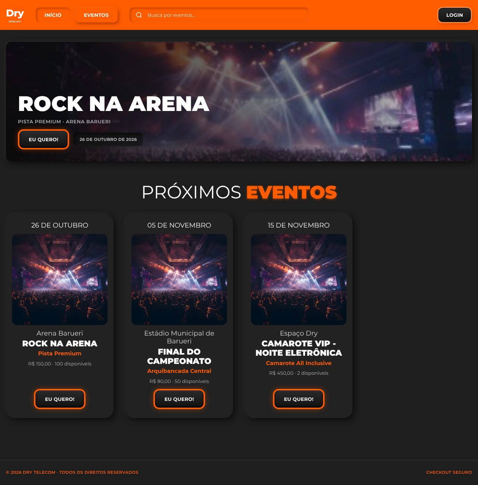
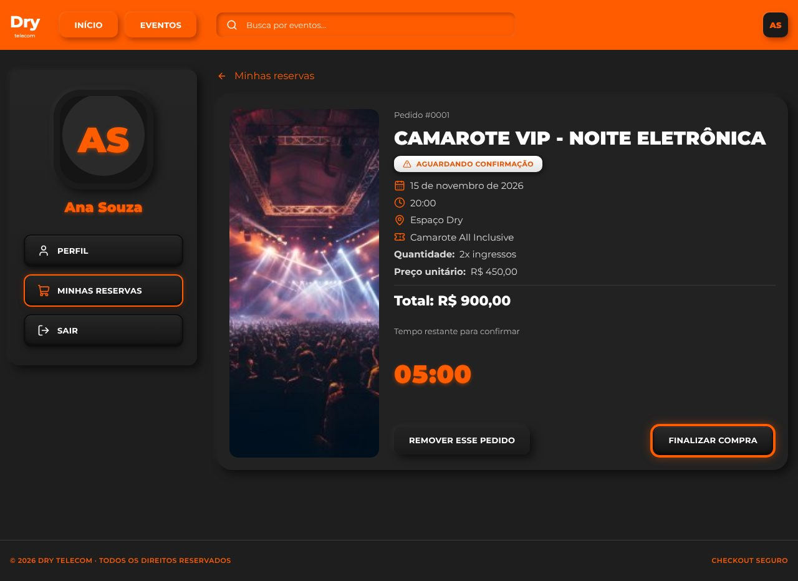
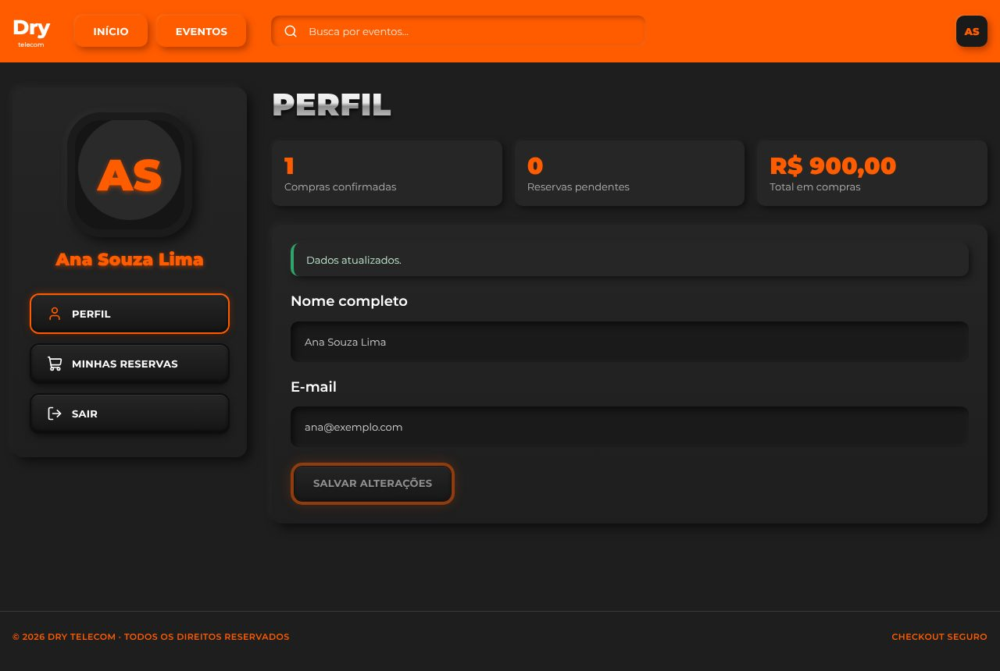
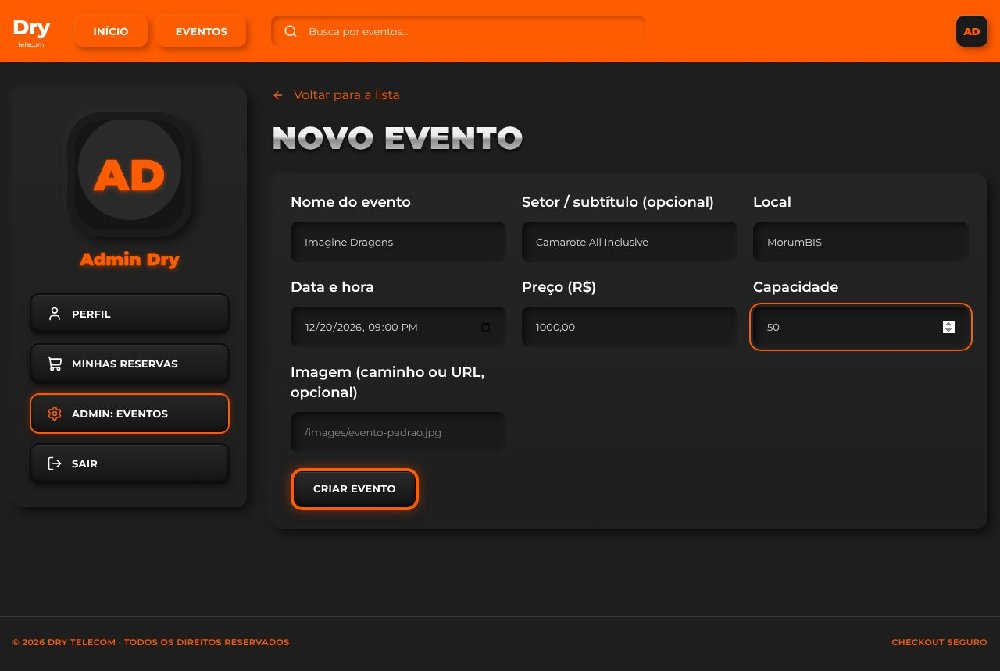
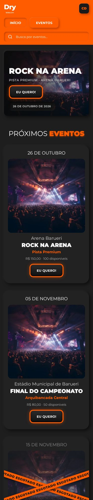

# Extras pós-entrega (branch `plus-features`)

A versão entregue do teste está congelada na branch **`entrega-v1`** e segue o enunciado à risca.
Esta branch acrescenta funcionalidades pedidas depois da aprovação, para aproximar a aplicação do Figma da Dry Telecom.

> **Atenção ao enunciado:** o teste diz "sem cadastro ou recuperação de senha" e que painel administrativo não é exigido.
> Por isso estes extras ficam numa branch separada e não fazem parte da avaliação original.

| Home pública | Cards com "esgotado" | Card de pedido |
|---|---|---|
|  |  |  |

| Perfil | Admin: novo evento | Celular |
|---|---|---|
|  |  |  |

## O que mudou

### Visual (Figma)
- **Botões:** o principal é escuro com moldura laranja brilhante ("EU QUERO!", "FINALIZAR COMPRA"); o secundário é escuro em relevo ("REMOVER ESSE PEDIDO").
- **Cabeçalho:** Início, Eventos, busca laranja e, à direita, "LOGIN" ou o avatar com as iniciais.
- **Home pública:** destaque do próximo evento disponível e a seção "PRÓXIMOS EVENTOS".
- **Card de evento:** data, imagem, local, nome, setor em laranja e "EU QUERO!". Quando o evento esgota ou já começou, o card fica apagado e ganha **fitas cruzadas de "ESGOTADO"**.
- **Card de pedido:** a reserva e "Minhas reservas" usam o layout de pedido do Figma, com imagem, número, selo de status, data, horário, setor, quantidade e total.
- **Área da conta:** sidebar com avatar grande, nome em laranja e menu (Perfil, Minhas reservas, Admin, Sair).
- **Imagem dos eventos:** imagem padrão em `frontend/public/images/evento-padrao.jpg`. Cada evento pode ter a sua (campo `image_url`).

### Funcionalidades
| Funcionalidade | API | Tela |
|---|---|---|
| Catálogo público | `GET /api/events` e `GET /api/events/:id` **sem login** | Home, Eventos e Detalhe abertos; "Entrar para reservar" volta ao evento depois do login |
| Cadastro | `POST /api/auth/register` → 201 + sessão; 409 `EMAIL_TAKEN` | `/register` |
| Perfil | `PATCH /api/auth/me` (só o nome) | `/profile`, com resumo de compras |
| Papéis | coluna `users.role` (`user` ou `admin`) | menu "Admin" só para admin |
| Admin de eventos | `POST /api/admin/events`, `PUT /api/admin/events/:id` (401 sem login, 403 sem papel admin) | `/admin/events`, `/admin/events/new`, `/admin/events/:id` |
| Busca sem acento | função SQL `unaccent()` registrada na conexão | "eletronica" encontra "Eletrônica" |

**Conta admin de demonstração:** `admin@exemplo.com` / `senha123`.

## Decisões e regras

- **Migration nova (`002_extras.sql`) em vez de editar a 001.** Um banco que já existia recebe só a parte nova com `npm run db:setup`, sem perder dados. A própria migration preenche subtítulo e imagem dos eventos antigos.
- **O papel nunca vem da requisição.** O cadastro sempre cria `user`, e campos como `"role": "admin"` são descartados pelo Zod. Há teste para isso.
- **Edição de capacidade protegida.** O admin não pode deixar a capacidade abaixo do que já está vendido ou reservado: a resposta é 409 `CAPACITY_BELOW_OCCUPIED`. A conta e o `UPDATE` rodam na mesma transação `BEGIN IMMEDIATE` das reservas, então uma reserva feita no meio da edição não fura a regra.
- **Mudar o preço não altera reservas existentes:** elas guardam o preço do momento em que foram feitas (`unit_price_cents`).
- **Sem "excluir evento".** Um evento com reservas não pode simplesmente sumir. Se for necessário, o caminho é um campo "ativo".
- **Imagem por caminho ou URL, sem upload.** O campo aceita `/images/...` ou `http(s)://...` e recusa `javascript:` e similares. Upload de arquivos exigiria armazenamento e validação de tipo e tamanho.
- **A tela de admin esconde o conteúdo de quem não é admin, mas a proteção real é a API (403).**
- **Busca sem acento:** o SQLite não tem `unaccent` nativo. A função é registrada em JS com `db.function(...)` e normaliza com `NFD` + remoção dos acentos + minúsculas.

## Testes

- Backend: **57** (eram 45). Os novos estão em `backend/tests/extras.test.ts`: cadastro, papel ignorado no payload, e-mail duplicado, perfil, 401/403 do admin, criação, validações (data passada, preço fracionário, capacidade zero, `javascript:`), capacidade abaixo do ocupado, preço que não altera reservas e busca sem acento.
- Frontend: **8** (eram 5): home pública com card esgotado, erro de cadastro por campo e bloqueio da área de admin.
- **Mudança intencional em teste antigo:** "eventos exigem autenticação" virou "catálogo é público". O cenário 5 do enunciado (401 nas rotas protegidas e isolamento entre usuários) continua coberto pelas rotas de reserva.

## Como atualizar o banco local

```powershell
npm install
npm run db:setup   # aplica a 002 e cria o admin, sem apagar nada
```
